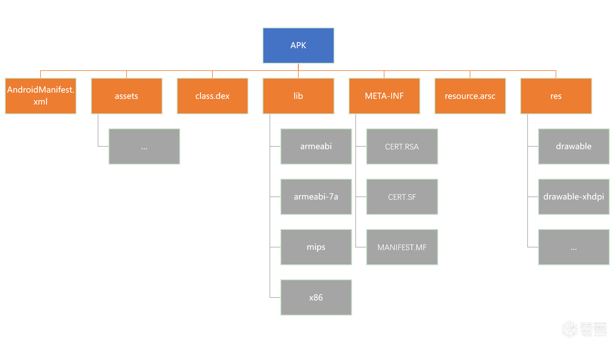
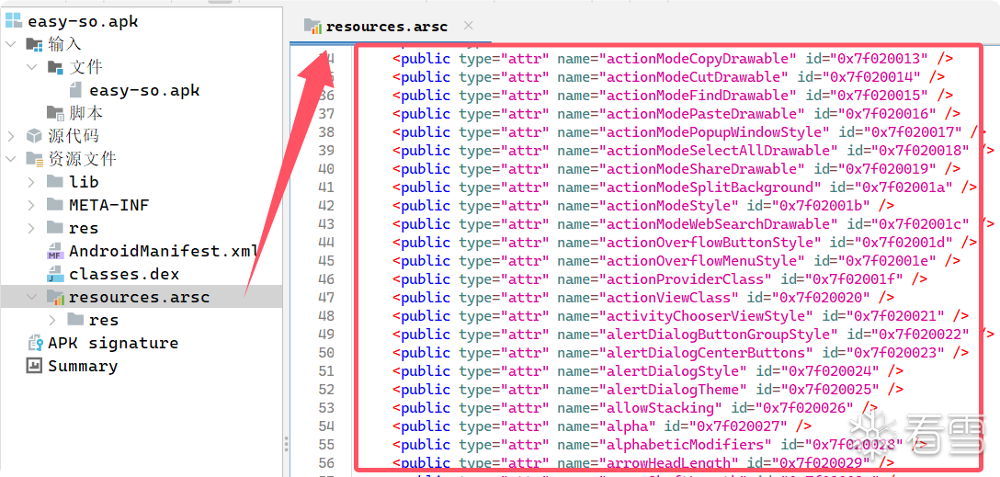

## APK 文件结构：逆向分析的静态入口

APK 本质上是一个压缩包，里面包含应用代码、资源、配置和签名信息。逆向第一步通常就是拆开 APK，看清楚这些文件各自负责什么。



| 文件或目录            | 作用                    | 逆向价值                           |
| --------------------- | ----------------------- | ---------------------------------- |
| `AndroidManifest.xml` | 应用全局配置文件        | 找包名、权限、组件、启动 Activity  |
| `classes.dex`         | Dalvik/ART 可执行字节码 | 核心 Java/Kotlin 业务逻辑          |
| `res/`                | 编译后的资源目录        | 布局、图片、字符串、控件 ID        |
| `resources.arsc`      | 编译后的资源映射表      | 资源 ID 与资源名称的映射           |
| `assets/`             | 原始资源目录            | 字体、音频、HTML、配置、加密数据等 |
| `lib/`                | Native so 库目录        | JNI、算法、加密校验、本地反调试    |
| `META-INF/`           | 签名与完整性校验信息    | 判断签名、完整性、二次打包痕迹     |

### 3.1 AndroidManifest.xml

`AndroidManifest.xml` 是每个 Android 应用的配置中心，可以理解为应用的“蓝图”。它声明应用包名、组件、权限、主题、图标、SDK 版本以及入口 Activity。

* 包名（`package="com.example.app"`）——应用的唯一标识

* 版本号、最低支持的安卓版本

* 有哪几个**组件**（Activity 界面、Service 后台服务、BroadcastReceiver 广播接收器、ContentProvider 数据提供者）

* 声明需要哪些**权限**（相机、网络、存储…）

* 哪个 Activity 是启动入口

逆向时首先关注：

- `package`：应用包名。
- `<uses-permission>`：权限声明。
- `<application>`：应用级配置，如图标、主题、Application 类。
- `<activity>`：Activity 声明。
- `<intent-filter>`：启动入口、广播响应等。
- `android:debuggable`：是否允许调试。
- `android:allowBackup`：是否允许备份数据。

一个简化的 Manifest 示例：

```xml
<?xml version="1.0" encoding="utf-8"?>
<manifest xmlns:android="http://schemas.android.com/apk/res/android"
    package="com.example.flag"
    android:versionCode="1"
    android:versionName="1.0">

    <uses-sdk
        android:minSdkVersion="8"
        android:targetSdkVersion="19" />

    <application
        android:theme="@style/AppTheme"
        android:label="@string/app_name"
        android:icon="@drawable/ic_launcher"
        android:debuggable="true"
        android:allowBackup="true">

        <activity
            android:name="com.example.flag.MainActivity"
            android:label="@string/app_name">
            <intent-filter>
                <action android:name="android.intent.action.MAIN" />
                <category android:name="android.intent.category.LAUNCHER" />
            </intent-filter>
        </activity>
    </application>
</manifest>
```

### 3.2 classes.dex

`classes.dex` 保存应用的 Dalvik 字节码。Java/Kotlin 源码经过编译后会进入一个或多个 DEX 文件中，例如 `classes.dex`、`classes2.dex`。

在 Android 5.0 之前，系统主要使用 Dalvik 虚拟机；Android 5.0 之后，ART(Android Runtime) 逐步取代 Dalvik。ART 支持 AOT 与 JIT 策略，执行效率更高。

对逆向而言，DEX 是静态分析的核心。如果 JADX 能正常反编译 DEX，通常可以直接阅读类、方法、字符串和控制流；如果 DEX 不完整或关键类缺失，就要怀疑是否存在加固或动态加载。

### 3.3 resources.arsc 与资源目录

`resources.arsc` 保存资源 ID 与资源名称的映射关系。它本身不直接存储图片或布局内容，而是帮助系统在运行时根据 ID 快速定位资源。



`res/` 目录中的资源会经过编译，常见子目录包括：

- `res/drawable/`：图片、图形资源。
- `res/layout/`：XML 布局文件。
- `res/values/`：字符串、颜色、尺寸、样式等定义。
- `res/values/strings.xml`：文本字符串。
- `res/values/colors.xml`：颜色资源。
- `res/values/styles.xml`：样式资源。

`assets/` 与 `res/` 的区别是：`assets/` 中的文件通常保持原始形态，不参与资源 ID 编译，运行时通过 `AssetManager` 读取。游戏资源、配置文件、加密数据有时会放在这里。

### 3.4 lib 与 META-INF

`lib/` 目录存放 Native 动态库，通常是 NDK 编译出的 `.so` 文件，并按 CPU 架构划分子目录，例如：

```text
lib/
  arm64-v8a/
  armeabi-v7a/
  x86/
```

如果 Java 代码中出现 `native` 方法或 `System.loadLibrary()`，就需要到 `lib/` 中找对应 so 文件。

`META-INF/` 存放签名和摘要信息，常见文件包括：

- `MANIFEST.MF`：APK 清单和文件摘要。
- `CERT.SF`：签名摘要。
- `CERT.RSA`：数字签名。

这些文件用于保证 APK 完整性和来源可信。逆向中可以通过签名变化判断样本是否被二次打包。


## 题目实践

## 整体逻辑顺下来,代码分析逻辑看得懂


