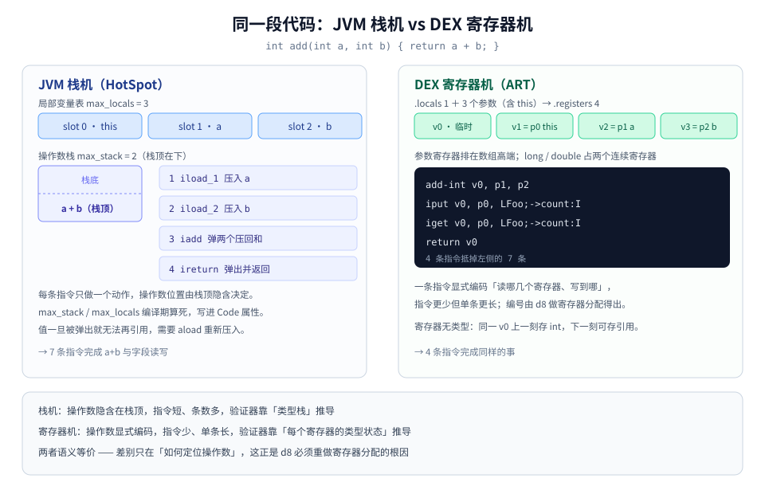
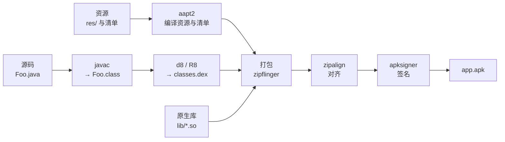
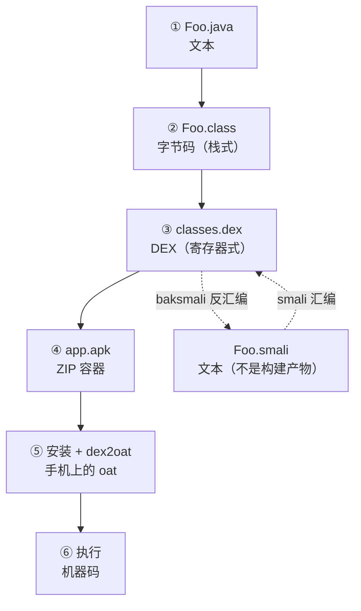
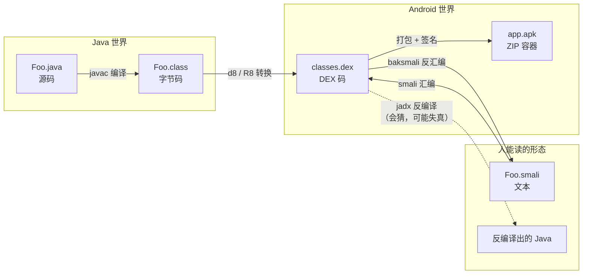
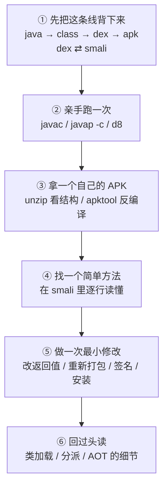

# 从 Java 源码到手机里的 smali

**一份给初学者的系统讲义**

---

## 写在前面：这份讲义想解决什么

上一份文档是"手册"，适合查，不适合学。这一份换个写法：**只讲一条线，从头讲到尾，每个名词都解释清楚**。

全文被三个问题牵着走：

1. 我写的 `.java` 文件，是怎么变成机器能跑的东西的？
2. 手机上那个 `.apk` 文件，里面到底装了什么？
3. 逆向时看到的那些 `.smali`，和我的 Java 代码是什么关系？

这三个问题不是并列的，是**同一条流水线的前、中、后**。你只要把中间那些"变身"的环节看清楚，三者的关系自然就出来了。

### 一句话主线

> Java 源码先被编译成一种叫 **字节码** 的中间语言；字节码在安卓上被重新打包成 **dex**；dex 用文本写出来就是 **smali**；而 **APK** 只是把 dex 和一堆资源装在一起的**包裹**。


这张图是全文的地图。看不懂没关系，读完第六部分再回来看，每个格子你都能讲出话来。

### 阅读约定

* 每个术语第一次出现，写成 **中文名（English，缩写）**，并且当场解释它是什么。

* 每个代码块上面都标了**这东西是谁生成的**，那行字比代码本身重要。

* 每章结尾有「小结」，作用是交代"下一章为什么必须存在"，建议别跳。

* 全文不涉及性能调优、虚拟机源码、JIT 汇编，那些属于下一层，这里只到"能讲清楚"为止。

### 目录

| 部分 | 内容                            | 回答的问题                     |
| ---- | ------------------------------- | ------------------------------ |
| 一   | 预备概念                        | 什么叫指令、编译、解释         |
| 二   | Java 源码 → 执行                | 问题 1                         |
| 三   | 安卓为什么要另起一套            | 为什么 `.class` 不能直接上手机 |
| 四   | APK 的结构                      | 问题 2                         |
| 五   | smali 是什么                    | 问题 3                         |
| 六   | 三者的咬合                      | 把它们串成一次完整旅程         |
| 附录 | 术语表 / 命令 / 自检 / 学习路径 | 备查                           |

***

# 第一部分 预备：三个必须先分清的名词

初学者最容易卡住的地方，不是某个复杂机制，而是**基础名词含义模糊**——比如把"编译"理解成"翻译整段话"，把"字节码"理解成"机器码的一种"。先把地基打平。

## 1.1 指令：计算机唯一认识的东西

**指令**（Instruction）是 CPU 能执行的最小动作单位。它不是"一行代码"，而是"一个动作"，比如：

* 把内存里某个地址的数搬到寄存器里（`MOV`）

* 把两个数加起来（`ADD`）

* 如果上一次比较结果是零，就跳到第 100 条指令去（`JE`）

* 从函数返回（`RET`）

一条指令只做一件事，做完就去看下一条。CPU 就是这样一条一条啃下去的。

这里出现了两个后面会反复用到的词：

* **寄存器**（Register）：CPU 内部极小的存储单元，一般只有十几个到几十个，每个存一个字长的数据。CPU 算东西必须先把数据放进寄存器。

* **内存地址**（Memory Address）：内存像一排带编号的抽屉，编号就是地址。

> **关键认知**：CPU 不认"变量名""函数名""类名"。这些名字是给人的。到了 CPU 那一层，只剩下"第几号寄存器""第几个地址""下一条指令在哪"。

## 1.2 从"一条指令"到"一个程序"

一个程序 = 一大堆指令，按顺序排好，存在文件里。CPU 执行时按顺序取，遇到跳转就跳到别处。这份"指令的排列"就叫**机器码**（Machine Code）。

机器码是二进制的，人几乎没法直接读。所以有了**汇编语言**（Assembly Language）：给每条机器指令起一个人能记的名字（`MOV`、`ADD`、`JMP`），一个助记符对应一条机器指令。

```
汇编（人写的）          机器码（CPU 读的）
  MOV  eax, 1      →     B8 01 00 00 00
  ADD  eax, 2      →     83 C0 02
  RET              →     C3
```

这个"汇编 ↔ 机器码"的对照关系，请记住，因为**第五部分要讲的 smali，本质上是给另一种机器码（dex）配的汇编语言**。

## 1.3 编译与解释：两种翻译方式

要把人写的高级语言变成 CPU 能跑的指令，有两种路子：

**编译**（Compile）：提前一次性翻译好，产出目标文件（机器码），以后直接跑目标文件。像把整本英文书翻译成中文出版，读者直接读中文本。C、C++、Go 走这条路。

**解释**（Interpret）：不产出目标文件，而是一边读源码一边翻译执行。像请一个同声传译，说一句翻一句。Python、Ruby 的传统实现走这条路。

**字节码 + 虚拟机**是第三种，也是 Java 的路子：先编译成一种中间的、不是机器码的"半成品语言"（字节码），运行时再由一个叫**虚拟机**的程序去执行它。虚拟机可以逐条解释字节码，也可以把热点部分当场编译成机器码。

> 为什么绕这么一圈？因为"半成品"不绑定任何 CPU。同一份字节码，Windows 的虚拟机能跑，ARM 手机的虚拟机能跑，x86 服务器的虚拟机能跑。这就是"一次编写，到处运行"的物理基础。

## 1.4 为什么需要"中间语言"

假设没有中间语言，你要为每种 CPU 架构（x86、ARM、MIPS…）各编译一份程序。手机换代、芯片换架构，程序全部重发。

有了中间语言，**架构差异被推迟到最后一刻**：源码 → 字节码（与架构无关）→ 由各平台的虚拟机负责"字节码 → 本地机器码"。

这个"最后一刻"发生在哪、由谁来做，正是 Java 与 Android 的第一个大分岔点（第三部分会讲）。

### 本章小结

* 指令 = CPU 的最小动作；机器码 = 指令序列；汇编 = 给人看的机器码写法。

* 编译 = 提前翻好；解释 = 当场翻；字节码 = 先翻成中间语言，运行时再定。

* **后面所有"变身"，本质上都是在换"指令的写法"，语义没变。**

***

# 第二部分 Java：源码如何变成可执行

这一部分只追一个问题：`Hello.java` 是怎么变成"能跑"的。

## 2.1 编译器不是"翻译整段话"，它分四步走

**编译器**（Compiler）在这里具体指 `javac`——Java 编译器。它读 `.java` 文件，产出 `.class` 文件。中间它做的事，可以粗暴分成四步：

| 步骤                          | 干什么                                                        | 打个比方             |
| ----------------------------- | ------------------------------------------------------------- | -------------------- |
| 词法分析（Lexical Analysis）  | 把字符流切成一个个"词"（`public`、`class`、`Hello`、`{`）     | 把句子切成单词       |
| 语法分析（Syntax Analysis）   | 把词按语法规则拼成**抽象语法树**（Abstract Syntax Tree, AST） | 把单词拼成句子结构图 |
| 语义分析与类型检查            | 检查名字有没有定义、类型对不对、方法签名是否匹配              | 检查句子合不合逻辑   |
| 生成字节码（Code Generation） | 把语法树翻译成一串字节码指令，写进 `.class`                   | 把句子翻成外语       |

中间还有一步叫**解语法糖**（Desugaring）：Java 里一些"好用的写法"（泛型、增强 for 循环、lambda、字符串拼接）其实不是虚拟机直接支持的，编译器会把它们改写成"朴素写法"再生成字节码。

> 这一点很重要，第五部分你会看到它的后果：**你在 smali 里找不到泛型，也找不到增强 for，因为它们从来没进过字节码。**

## 2.2 第一个澄清：`.class` 不是可执行文件

很多人以为 `javac` 生成的是"能跑的程序"。不是。

* `.exe` / ELF 这类**可执行文件**（Executable File）：CPU 能直接执行，里面是机器码。

* `.class` 是**类文件**（Class File）：它不是给 CPU 的，是给**虚拟机**的。你不装 Java 运行时，双击它什么都不会发生。

`.class` 里装的是四类东西：

1. **类的基本信息**：类名、父类、实现的接口、访问修饰符（`public`/`final`…）
2. **字段表**（Field Table）：有哪些成员变量，各是什么类型
3. **方法表**（Method Table）：有哪些方法，参数和返回值是什么，以及**每个方法的方法体被编译成的那串指令**
4. **常量池**（Constant Pool）：这张表最特别，见下。

**常量池**（Constant Pool）是一个"字符串和符号的仓库"。代码里出现的类名、方法名、字段名、字符串字面量、数字常量，都先在常量池里登记一个编号，指令里只写编号。这样做的目的是**省空间**——同一个类名在文件里出现 50 次，实际只存一份，其余位置存编号。

> 记住"指令里引用的是常量池的编号"这件事。你在 `javap` 输出里看到 `invokevirtual #7` 这种写法时，`#7` 就是常量池编号。

## 2.3 字节码长什么样：从 add 方法看起

**字节码**（Bytecode）就是 `.class` 里那些指令。它不是机器码，也不是源码，是一种为虚拟机设计的指令集。

看一个最简单的例子：

```java
// 源码：Foo.java（人写的）
public class Foo {
    public int add(int a, int b) {
        return a + b;
    }
}
```

```text
// 反编译结果：javap -c Foo 的输出（javac 生成的 .class 里读出来的）
public int add(int, int);
  Code:
     0: iload_1        // 把第 1 号局部变量压到栈顶
     1: iload_2        // 把第 2 号局部变量压到栈顶
     2: iadd           // 弹出栈顶两个数，相加，结果压回栈顶
     3: ireturn        // 弹出栈顶的数，作为返回值返回
```

四行，做完了 `a + b`。注意几件事：

* 每行开头有个数字（0, 1, 2, 3），这是**指令偏移量**（Offset），也可以理解为"这条指令在第几个字节"。跳转就是跳到这些数字上。

* `i` 前缀表示 **int**。`iadd` 是 int 加法，`fadd` 是 float 加法，`ladd` 是 long 加法。类型写在助记符里，这是 JVM 字节码的特点。

* **没有"变量 a"这种东西**，只有"第 1 号局部变量"。名字在编译时就已经被丢掉了（除非加调试选项）。

* 第 0 号局部变量是谁？是 `this`。**实例方法的第 0 号位置永远留给** **`this`**，参数从 1 号开始。这是初学者最容易数错的地方。

## 2.4 栈与局部变量表：字节码世界的两块场地

上面 `iload_1` "压到栈顶"——压到哪个栈？这就要讲虚拟机的两大车间。

**局部变量表**（Local Variable Table, LVT）：一个方法的参数和局部变量都住在这里，按编号排好（0 号、1 号、2 号…）。它像一个储物柜。

**操作数栈**（Operand Stack）：一个临时工作台，先进后出。指令算东西时，从储物柜取出数据放到工作台，算完再放回储物柜。它像一个只能从上面取放的盘子堆。


把 `add(3, 5)` 的执行过程摊开看：

| 步骤 | 指令      | 局部变量表           | 操作数栈（底 → 顶） |
| ---- | --------- | -------------------- | ------------------- |
| 初始 | —         | `0:this` `1:3` `2:5` | 空                  |
| ①    | `iload_1` | 不变                 | `3`                 |
| ②    | `iload_2` | 不变                 | `3, 5`              |
| ③    | `iadd`    | 不变                 | `8`                 |
| ④    | `ireturn` | 不变                 | 空（8 被返回出去）  |

看懂这张表，你就看懂了字节码的执行模型：**一切运算都是"从储物柜搬到工作台，算完搬回去"**。

这种设计叫**栈式架构**（Stack-based Architecture）。它的好处是指令极短（不用写"用哪个寄存器"，因为操作数永远在栈顶），坏处是指令条数多（搬来搬去）。

> 第三部分你会看到，安卓把"栈"换成了"寄存器"，于是同样一段逻辑只要两条指令——这就是 dex 的由来。

## 2.5 JVM：一个假装自己是电脑的程序

**JVM**（Java Virtual Machine，Java 虚拟机）是一个普通的应用程序，它跑在你的操作系统上，对外提供"一台假的电脑"。

它假在哪儿？它自己定义了一套指令集（就是字节码），自己定义了内存布局（栈、堆、方法区），自己负责把字节码变成真正 CPU 能做的工作。

JVM 运行时，内存大致分五块：

| 区域                | 中文名     | 装什么                                               | 谁共享       |
| ------------------- | ---------- | ---------------------------------------------------- | ------------ |
| Heap                | 堆         | 所有 `new` 出来的对象                                | 所有线程共享 |
| Method Area         | 方法区     | 类的结构信息、常量池、静态变量                       | 所有线程共享 |
| VM Stack            | 虚拟机栈   | 每个方法调用一个"栈帧"，栈帧里放局部变量表和操作数栈 | 每线程一份   |
| Native Method Stack | 本地方法栈 | 给 native 方法（C/C++ 写的）用的                     | 每线程一份   |
| PC Register         | 程序计数器 | 当前线程执行到字节码的第几条指令                     | 每线程一份   |


**栈帧**（Stack Frame）是理解"方法调用"的钥匙：每调用一个方法，就压一个栈帧；方法返回，栈帧弹出。局部变量表和操作数栈都住在栈帧里。所以"方法 A 调用方法 B"在内存里就是"栈上多了一层"。

## 2.6 类加载：字节码怎么进到内存里

`.class` 文件躺在硬盘上，JVM 要执行它，得先把它读进内存。这个过程叫**类加载**（Class Loading），干这活的组件叫**类加载器**（ClassLoader）。

流程分五步，初学者只需要理解前三步的意图：

| 步骤           | 中文   | 做什么                                                                     |
| -------------- | ------ | -------------------------------------------------------------------------- |
| Loading        | 加载   | 找到 `.class` 文件，把字节流读进来，生成一个 Class 对象                    |
| Verification   | 验证   | 检查字节码格式对不对、有没有越界、类型是否安全（防有人手改字节码搞破坏）   |
| Preparation    | 准备   | 给静态变量分配内存，赋**零值**（注意：不是代码里写的初始值）               |
| Resolution     | 解析   | 把常量池里的"符号引用"换成真正的内存地址                                   |
| Initialization | 初始化 | 执行静态变量赋值和静态代码块（编译器把它们打包成一个叫 `<clinit>` 的方法） |

两个容易搞混的点：

**① 准备阶段赋零值，不是赋你写的值。**

```java
static int count = 100;
```

准备阶段 `count` 是 `0`；到初始化阶段执行 `<clinit>` 才变成 `100`。所以"静态变量在类初始化时才真正有值"。

**② 什么时候触发初始化？** 首次主动使用该类时——`new` 它、读它的静态字段、调它的静态方法、反射它、初始化它的子类。只"声明一个引用"不会触发。

**双亲委派**（Parent Delegation）是类加载器的工作规则：收到加载请求，先交给父加载器，父加载器干不了才自己干。好处是核心类库（`java.lang.String`）不会被你自己写的同名类顶替掉。

## 2.7 字节码怎么被执行：解释、JIT、AOT

字节码进了内存，接下来的执行方式有三种，现代 JVM 是**混合**着用的：

**解释执行**（Interpretation）：虚拟机一条一条读字节码，读一条执行一段等价的机器码。启动快，但每条都要现翻，慢。

**即时编译**（Just-In-Time Compilation, JIT）：运行中统计哪些方法和循环被执行得特别频繁（叫**热点**，Hot Spot），把这些热点**整段编译成机器码**缓存起来，下次直接跑机器码。跑得越久越快，但编译本身要花时间和内存。

**提前编译**（Ahead-Of-Time Compilation, AOT）：在程序运行之前就把字节码编译成机器码。启动快，但不能根据实际运行情况优化。

```
第一次执行 add()  → 解释执行（慢）ˊ
第 10000 次执行   → 已被 JIT 编译成机器码（快）
```

> JVM 的典型策略：先解释执行，发现热点就 JIT 编译，编译后的代码如果发现假设不成立（比如某个接口突然多了一个实现类），就**退回去重新解释**（叫去优化，Deoptimization）。这一层知道有这回事就够了。

## 2.8 小结：Java 换来了什么，付出了什么

到这里，Java 的完整链路是清楚的：

```
Foo.java --javac--> Foo.class（字节码）--类加载--> 内存 --解释/JIT--> 机器码 --CPU--> 执行
```

**换来的**：跨平台、内存安全（虚拟机管内存，不会野指针）、动态加载（可以运行时加载新类）。

**付出的**：多了一层虚拟机，启动慢、占内存、峰值性能不如手写 C++（JIT 之后能追平很多场景）。

而安卓面对的正是"付出"那一栏——手机内存小、CPU 弱、电量有限、还要秒开。于是安卓做了一个大胆的决定：**把 JVM 换掉**。

***

# 第三部分 安卓为什么要另起一套

这一部分是 Java 与 Android 的分岔口，也是理解"为什么会有 dex"的唯一入口。

## 3.1 手机不是缩小版电脑

2007 年安卓起步时的现实：

| 约束                              | 后果                                                                            |
| --------------------------------- | ------------------------------------------------------------------------------- |
| 内存只有几十 MB                   | 每个类加载进来都占内存，`.class` 文件里大量重复的字符串（类名、方法名）浪费严重 |
| CPU 主频几百 MHz，没有 JIT 的余力 | 纯解释执行必须尽量快，指令越少越好                                              |
| 电池有限                          | 少做无用功                                                                      |
| 应用启动要快                      | 不能等一堆小文件逐个读盘                                                        |

一个中等规模的 Java 程序，编译出来可能有几千个 `.class` 文件。每个文件都自带一份常量池，**同一个** **`java/lang/String`** **在几千个文件里各存一份**。这在桌面上无所谓，在 2007 年的手机上是要命的。

## 3.2 dex：把一堆 .class 压成一张表

安卓的解法叫 **DEX**（Dalvik Executable）。它是一个**容器格式**，把整个应用的所有 `.class` 合并进一个文件，关键在于：

* **所有类共用一张常量池**。`java/lang/String` 只存一次，全应用共享。这一下省掉大量重复。

* **所有类、方法、字段被排成有序的索引表**，查找从"遍历文件"变成"查表"。

* **指令从栈式改成寄存器式**，指令条数大约减少三分之一。

```
传统 Java：  A.class  B.class  C.class  ...（各有各的常量池，互相重复）
Android：    classes.dex（一张共享常量池 + 所有类的方法体）
```

生成 dex 的工具叫 **d8**（早期的叫 dx，已被 d8 取代）；如果还要做代码压缩混淆，用的是 **R8**。

> 一个 dex 文件有一个硬限制：方法引用不能超过 65536 个（因为索引是 16 位）。这就是"方法数超 64K"的由来，解决办法是把代码拆成 `classes.dex`、`classes2.dex`…（叫 **multidex**，多 dex）。

## 3.3 寄存器机 vs 栈机：同样的加法，两种写法

这是全文最值得停下来看的一处对照。



**JVM 的写法**（栈式）：

```
iload_1      ；把 a 压栈
iload_2      ；把 b 压栈
iadd         ；弹两个、加、压回
ireturn      ；弹出返回
```

4 条指令。每条指令都很短（一个字节的操作码 + 最多两个字节的操作数）。

**DEX 的写法**（寄存器式）：

```
add-int v0, p1, p2    ；v0 = p1 + p2，直接指定"用哪几个格子"
return v0             ；返回 v0
```

2 条指令。每条指令更长（要写明三个寄存器编号），但条数少。

**为什么寄存器式在手机上更划算**：

* 指令条数少 → 解释器循环次数少 → 执行快（在没有 JIT 的年代这点极其重要）

* 不需要维护一个操作数栈 → 每条指令的"搬运"开销没了

* 代价是指令编码更长（一条指令占 2\~5 个 16 位单元），但 dex 用**变长编码**把这个代价压下去了

代价还有一点：**寄存器式指令不好写、不好验证**。所以 dex 的校验比 `.class` 复杂得多，这也是为什么手写 dex 几乎不可能，而手写 smali 却可行（第五部分会解释）。

## 3.4 从 Dalvik 到 ART：一段必须知道的历史

**Dalvik**（达尔维克）是安卓 4.4 及以前的虚拟机，专门为 dex 设计，纯解释执行 + 一个简单的 JIT。

**ART**（Android Runtime，安卓运行时）从 Android 5.0 起取代 Dalvik，最大的变化是引入 **AOT 编译**：应用**安装时**就把 dex 编译成机器码（`.oat` 文件），以后直接跑机器码，启动快、执行快，代价是安装慢、占空间大。

后来的演进（了解即可，不必深究）：

* Android 7 起改成**混合模式**：安装时不编译，先解释执行，闲时在后台偷偷编译热点（叫 **profile-guided**，按使用记录优化）

* Android 9 起 dex 被拆成 `.vdex`（校验过的 dex）+ `.odex`/`.oat`（编译产物）

* 云编译、Baseline Profile 等优化，都是这条线的延伸

> **一句话**：Dalvik 是"解释器"，ART 是"解释器 + 编译器"。你写的 dex 在两者眼里都是同一份输入。

## 3.5 小结：变的是形态，不变的是语义

到这里可以回答"为什么安卓不用 `.class`"了：

| 问题             | Java 的答案          | 安卓的答案                   |
| ---------------- | -------------------- | ---------------------------- |
| 用什么装代码     | 一个类一个 `.class`  | 全应用一个 `classes.dex`     |
| 指令怎么算       | 栈式（操作数在栈顶） | 寄存器式（操作数在指定格子） |
| 谁执行           | JVM                  | ART（早期是 Dalvik）         |
| 何时编译成机器码 | 运行时 JIT           | 安装时 AOT / 运行时 JIT      |

**但语义完全一样**：`a + b` 在两边都是加法，`if` 在两边都是条件跳转，对象在两边都是 `new` 出来的。变的只是"怎么写"，不是"是什么"。

> 记住这句，它是第四、第五部分的通行证：**dex 是字节码的另一种写法，不是另一种东西。**

***

# 第四部分 APK 是什么

前面一直在说"打包成 APK"。这一部分拆开看，APK 里到底有什么。

## 4.1 APK 就是一个 ZIP 压缩包

**APK**（Android Package，安卓安装包）本质上是一个 **ZIP 压缩包**，只是后缀改成了 `.apk`。

你可以直接把 `app.apk` 改名成 `app.zip` 然后用解压软件打开——会看到一堆文件。这说明 APK 不是什么神秘格式，它就是个容器。

**容器**（Container）这个词要理解准：容器本身不执行任何逻辑，它只负责"把若干文件按约定放在一起"，再加一些元信息（比如"哪个文件是入口"）。

用命令行看它的内容：

```bash
unzip -l app.apk        # 列出压缩包里的文件
```

## 4.2 一个 APK 的全家福


| 文件 / 目录           | 必须吗    | 是什么                   | 对应 Java 世界的什么               |
| --------------------- | --------- | ------------------------ | ---------------------------------- |
| `AndroidManifest.xml` | 必须      | 应用清单（二进制格式）   | 相当于"程序的身份证 + 配置表"      |
| `classes.dex`         | 必须      | 编译后的代码             | 相当于所有 `.class` 的合订本       |
| `classes2.dex`…       | 可选      | 多 dex 的后续包          | 方法数超 64K 时的分册              |
| `resources.arsc`      | 有资源时  | 编译后的资源索引表       | 相当于 `R.java` 里那些数字背后的表 |
| `res/`                | 有资源时  | 编译后的资源文件         | 图片、布局、字符串                 |
| `assets/`             | 可选      | 原样打包的文件           | 不编译，读的时候自己解析           |
| `lib/<架构>/*.so`     | 可选      | 原生库（C/C++ 编译产物） | JNI 用的                           |
| `META-INF/`           | v1 签名时 | 签名文件                 | 证明"这个包是谁做的、没被改过"     |

## 4.3 清单：AndroidManifest.xml

这个文件规定了这个应用的"身份"和"能力"：

**为什么打开是乱码？** 因为打进 APK 之前，它被 `aapt2` 转成了**二进制 XML**（Binary XML，格式代号 AXML）。转换的目的是：

* 解析快：不用做文本扫描和字符串比较

* 体积小：属性名从字符串变成 16 位数字 ID（`android:name` 变成 `0x01010003`）

想看可读版本用：

```bash
apktool d app.apk              # 反编译，得到可读的 AndroidManifest.xml
# 或
aapt2 dump xmltree app.apk --file AndroidManifest.xml
```

> 这一点是理解"APK 里的文件为什么都不是原样"的第一个例子。**打包过程会改造文件格式**，资源如此，代码更是如此。

## 4.4 classes.dex：真正会执行的代码

这是 APK 的心脏。你的所有 Java（和 Kotlin）代码，最终都在这里。

它和 `.class` 的区别，前面讲过三点（共享常量池、索引表、寄存器指令）。从"阅读"角度还要补一点：**dex 把所有类的方法体集中存放在文件的 data 区**，每个方法的方法体是一段 `code_item`，包含：

* `registers_size`：这个方法一共用多少个寄存器

* `ins_size`：有几个参数寄存器（含 `this`）

* 一串指令（每 2 字节为一个单元，称 code unit）

```text
code_item 的字段（节选，单位：16 位）
  registers_size   这个方法总共几个寄存器
  ins_size         其中几个是参数（含 this）
  outs_size        调用别的方法时最多要传几个参数
  tries_size       有几个 try-catch 块
  insns_size       指令有多少个 code unit
  insns[]          指令本体
```

这套字段和第五部分要讲的 smali 头部**一一对应**——你现在看到的每个数字，在 smali 里都有一行 `.registers` / `.locals` 之类的声明。

## 4.5 资源：resources.arsc 与 res/

Java 代码里写 `R.string.app_name`，编译后变成一个整数（比如 `0x7f0b0012`）。这个整数不是随便编的，它是**资源表的坐标**：

```
0x7f 0b 0012
 │    │   └─ 条目序号：第 18 个
 │    └───── 类型：0x0b = string
 └────────── 包 ID：0x7f = 本应用
```

`resources.arsc` 就是这张坐标表的实体，`res/` 里则是坐标指向的真实文件（图片、布局 XML——注意布局 XML 也被编译成了二进制）。

## 4.6 lib/：原生库

有些功能用 Java 写不了或不够快（音视频解码、图像处理、加密），会用 C/C++ 写，编译成 `.so` 文件（Linux 的动态链接库）。Java 通过 **JNI**（Java Native Interface，Java 本地接口）调用它们。

`lib/` 下面按 **ABI**（Application Binary Interface，应用二进制接口）分目录：`arm64-v8a`、`armeabi-v7a`、`x86_64`…每个目录一份对应的编译产物。这就是为什么一个 APK 动辄几十 MB——它把好几种 CPU 架构的库都带上了。

## 4.7 签名：为什么改一个字节就装不上

安卓要求每个 APK 必须**签名**（Sign）。签名解决两个问题：

1. **身份**：这个包是"谁"发布的（同一个包名，签名不同就不能覆盖安装）
2. **完整性**：从签名到现在，文件有没有被改过

有三代签名，机制不同：

| 版本                          | 机制                                               | 覆盖范围     |
| ----------------------------- | -------------------------------------------------- | ------------ |
| v1（JAR 签名）                | 对每个文件算摘要，摘要写进 `META-INF/`             | 逐个文件     |
| v2（APK Signature Scheme v2） | 对整个 APK 算 Merkle 树，摘要放在 ZIP 的"签名块"里 | 整个文件字节 |
| v3                            | 在 v2 基础上支持密钥轮换                           | 整个文件字节 |

**这解释了一个非常实际的现象**：你反编译 APK、改了一行 smali、重新打包，装不上，报"签名不一致"。因为文件字节变了，摘要对不上。

解决办法是**重新签名**：

```bash
apksigner sign --ks my.keystore app.apk
```

> 顺便记住顺序：**先对齐（zipalign）再签名**。因为 v2/v3 覆盖整个文件字节，签完名再动文件就废了。

## 4.8 这些文件是谁生成的：构建流水线

APK 不是手搓的，是一串工具接力做出来的：



每一步的产物你都能在构建目录里找到（`build/intermediates/` 下面），这是排查"为什么我的 APK 里没有某个类"的最佳地点。

## 4.9 小结：APK 各文件 ↔ 程序概念

| 程序里的概念               | APK 里的落点              |
| -------------------------- | ------------------------- |
| 代码逻辑                   | `classes.dex`             |
| 类结构、方法签名、常量     | `classes.dex` 里的索引表  |
| 资源（字符串、图片、布局） | `res/` + `resources.arsc` |
| 应用配置、组件声明、权限   | `AndroidManifest.xml`     |
| 原生代码                   | `lib/<abi>/*.so`          |
| 身份与完整性               | `META-INF/` + 签名块      |

到这里，你打开一个 APK 的 `classes.dex`，会看到一堆二进制。**人读不了**。于是有了下一部分的主角。

***

# 第五部分 smali：dex 的可读写法

## 5.1 smali 不是一门语言，是 dex 的文本形态

先把最容易误解的一点说清：

**smali 不是一种编程语言，它没有编译器，也没有自己的语义。它只是 dex 的助记符写法。**

就像汇编不是"一种高级语言"，只是机器码的助记符写法一样。

两者的关系是**双向**的：

```
classes.dex  --baksmali（反汇编）-->  一堆 .smali 文本文件
一堆 .smali  --smali（汇编）-->      classes.dex
```

* **反汇编**（Disassemble）：把二进制指令翻成文本助记符

* **汇编**（Assemble）：把文本助记符翻回二进制

> 注意"几乎无损"这四个字：dex → smali → dex，指令和结构都在，丢掉的只是部分调试信息（行号、局部变量名，除非原来就带）。这是 smali 区别于 `jadx` 那种"反编译成 Java 源码"的关键——**反编译会猜，反汇编不会猜**。

## 5.2 为什么要有它

三个理由，按重要性排：

1. **二进制不可编辑**。想改一个方法的返回值，改二进制几乎不可能；改文本 smali 则很容易。
2. **反编译成 Java 会失真**。`jadx` 把 dex 还原成 Java，遇到混淆代码、lambda、内联优化时会"猜错"，生成的 Java 甚至编译不过。smali 是 dex 的忠实映射，不猜。
3. **它是 dex 与人的最小距离**。看懂 smali 就等于看懂 dex，中间不再隔一层翻译。

## 5.3 一个 .smali 文件的骨架

一个类对应一个 `.smali` 文件。骨架长这样（以 `Foo` 为例）：

```smali
.class public Lcom/example/Foo;      # 类声明：访问标志 + 全限定名
.super Ljava/lang/Object;            # 父类
.source "Foo.java"                   # 源文件名（调试用，可无）

# 字段声明
.field private static final TAG:Ljava/lang/String; = "Foo"

# 方法声明
.method public constructor <init>()V
    .locals 0
    invoke-direct {p0}, Ljava/lang/Object;-><init>()V
    return-void
.end method
```

逐条解释这些**指示符**（Directive，以 `.` 开头的行，它们不是指令，是给汇编器看的元信息）：

| 指示符                    | 含义                                  |
| ------------------------- | ------------------------------------- |
| `.class`                  | 这个类的访问标志和名字                |
| `.super`                  | 父类                                  |
| `.implements`             | 实现的接口                            |
| `.field`                  | 成员变量                              |
| `.method` / `.end method` | 方法开始/结束                         |
| `.locals N`               | 这个方法用 N 个局部寄存器（不含参数） |
| `.registers N`            | 这个方法总共 N 个寄存器（含参数）     |
| `.param`                  | 给参数起名字（调试用）                |
| `.line N`                 | 对应源码第 N 行（调试用）             |
| `.catch`                  | try-catch 块                          |

**类型描述符**（Descriptor）在这里必须认识，它是 dex 里表示类型的写法：

| Java 类型    | smali 写法             | 记忆方法                       |
| ------------ | ---------------------- | ------------------------------ |
| `int`        | `I`                    | Integer                        |
| `long`       | `J`                    | 因为 L 已经被对象占了          |
| `boolean`    | `Z`                    | Zero/布尔                      |
| `void`       | `V`                    | Void                           |
| `String`     | `Ljava/lang/String;`   | L 开头、分号结尾，中间是包路径 |
| `int[]`      | `[I`                   | 一个 `[` 是一维数组            |
| `String[][]` | `[[Ljava/lang/String;` | 两个 `[` 是二维                |

> 记住两条：**对象类型用** **`L包/类名;`，基本类型用单个大写字母**。看到 `Lcom/example/Foo;` 就读作"com.example.Foo 这个类"。

## 5.4 寄存器：smali 最核心的概念

smali 里没有"变量名"，只有**寄存器**（Register），用 `v` 和 `p` 编号：

* `v0`、`v1`、`v2`… 是**局部寄存器**（Local Register），放局部变量和中间结果

* `p0`、`p1`、`p2`… 是**参数寄存器**（Parameter Register），放参数

**关键规则**：参数寄存器位于所有寄存器的**末尾**，`p0` 是最后一个"参数区"的起点。而且 `p0` 在实例方法里就是 `this`。

### 手算一遍：最容易出错的地方

假设：

```smali
.method public add(II)I
    .locals 1          # 1 个局部寄存器
    ...
.end method
```

翻译成人话：

* 参数有 2 个（`I` 和 `I`），再加上隐式的 `this`，所以**参数寄存器有 3 个**：`p0=this`、`p1=第一个 int`、`p2=第二个 int`

* `.locals 1` 说明有 1 个局部寄存器：`v0`

* 总寄存器数 = 1（局部） + 3（参数） = 4，编号是 `v0, v1, v2, v3`

* 而 `p0` 是"参数区第一个"，也就是 `v1`；`p1` = `v2`；`p2` = `v3`

于是两个名字的对应关系：

```
v0  = 唯一的局部变量
v1  = p0 = this
v2  = p1 = a
v3  = p2 = b
```

所以 `a + b` 的指令是：

```smali
add-int v0, p1, p2     # v0 = a + b
```

**如果你写成** **`add-int v0, p0, p1`，那就是** **`this + a`，绝对错。** 这是初学者第一号错误，务必手算两三遍直到不用想。

> 宽类型（`long`、`double`）占**两个**寄存器。如果 `p2` 是一个 `long`，那它占 `v3` 和 `v4`，下一个参数就从 `v5` 开始。这是第二号错误来源。

## 5.5 读一个方法：从 smali 翻回 Java

拿一个带字段访问和条件判断的方法：

```java
// Java 源码
public int getScore(int bonus) {
    if (bonus > 0) {
        this.score = this.score + bonus;
    }
    return this.score;
}
```

```smali
# baksmali 生成的 Foo.smali（节选）
.method public getScore(I)I
    .locals 1                      # 1 个局部：v0

    if-lez p1, :cond_0             # 如果 p1 <= 0，跳到 :cond_0
    iget v0, p0, Lcom/example/Foo;->score:I   # v0 = this.score
    add-int/2addr v0, p1           # v0 += p1
    iput v0, p0, Lcom/example/Foo;->score:I   # this.score = v0

    :cond_0
    iget v0, p0, Lcom/example/Foo;->score:I   # v0 = this.score
    return v0
.end method
```

一段一段读：

* `if-lez p1, :cond_0` —— **lez** 是 "less or equal zero"，即"如果 `p1 <= 0` 就跳到标签 `:cond_0`"。注意它表达的是**取反的条件**：源码写 `if (bonus > 0)` 才执行，字节码就写成"不满足时跳过"。

* `iget v0, p0, ...->score:I` —— **i** 表示 instance（实例字段），**get** 是取值。整句：从 `p0`（也就是 `this`）的 `score` 字段取值，放进 `v0`。

* `add-int/2addr v0, p1` —— 带 `/2addr` 后缀的版本是"结果写回第一个操作数"，等价于 `v0 = v0 + p1`。这是 d8 的常用优化，省一个寄存器。

* `iput v0, p0, ...->score:I` —— **put** 是赋值，把 `v0` 写进 `this.score`。

* `:cond_0` —— **标签**（Label），跳转指令的目标。它对应原来 `if` 结束的位置。

把它翻回 Java，就是开头那段。**你不需要读懂所有指令，只要认得出"条件跳转、字段读写、方法调用、返回"这四类，就能读懂 80% 的 smali。**

## 5.6 指令速记：先认这五类

### ① 方法调用（最重要）

| 指令               | 中文         | 什么时候用                |
| ------------------ | ------------ | ------------------------- |
| `invoke-virtual`   | 调用虚方法   | 普通实例方法（可被重写）  |
| `invoke-direct`    | 调用直接方法 | 构造器 `<init>`、私有方法 |
| `invoke-static`    | 调用静态方法 | `static` 方法             |
| `invoke-interface` | 调用接口方法 | 通过接口调用              |
| `invoke-super`     | 调用父类方法 | `super.xxx()`             |

调用完如果要拿返回值，必须紧跟一条 **`move-result`**：

```smali
invoke-static {}, Ljava/lang/System;->currentTimeMillis()J
move-result-wide v0            # 把返回值放进 v0（long 用 wide）
```

> `move-result` 必须**紧跟**在 invoke 之后，中间不能插别的指令。这是 smali 的硬规则。

### ② 字段访问

| 指令            | 含义             |
| --------------- | ---------------- |
| `iget` / `iput` | 实例字段 读 / 写 |
| `sget` / `sput` | 静态字段 读 / 写 |

### ③ 数据移动与常量

| 指令                                   | 含义                                 |
| -------------------------------------- | ------------------------------------ |
| `move` / `move-object` / `move-result` | 寄存器之间搬数据                     |
| `const/4` `const/16` `const`           | 放一个整数常量（数字越小，指令越短） |
| `const-string`                         | 放一个字符串常量                     |

### ④ 跳转与比较

| 指令                                            | 含义                        |
| ----------------------------------------------- | --------------------------- |
| `if-eq` `if-ne` `if-lt` `if-ge` `if-gt` `if-le` | 两寄存器比较后跳转          |
| `if-eqz` `if-nez` `if-ltz` …                    | 与 0 比较后跳转（z = zero） |
| `goto` / `goto/16`                              | 无条件跳转                  |
| `packed-switch` / `sparse-switch`               | switch 语句                 |

### ⑤ 返回

`return-void`、`return`、`return-object`、`return-wide`。

## 5.7 工具三条

| 工具         | 干什么                          | 典型命令                                         |
| ------------ | ------------------------------- | ------------------------------------------------ |
| **baksmali** | dex → smali（反汇编），只做代码 | `baksmali d classes.dex -o out/`                 |
| **smali**    | smali → dex（汇编），只做代码   | `smali a out/ -o classes.dex`                    |
| **apktool**  | 整套反编译：资源 + 清单 + smali | `apktool d app.apk` / `apktool b app -o new.apk` |

apktool 内部就是调 baksmali 和 aapt2 帮你把活串起来。要改代码就用 baksmali/smali 这对（干净），要改资源就用 apktool（它会同时处理资源索引）。

## 5.8 小结

* smali = dex 的文本写法，与 dex 可双向转换，不是新语言。

* 三个必须记住的规则：`p0` 是 `this`、`.locals` 不含参数、`move-result` 紧跟 `invoke`。

* 读 smali 的顺序：先看 `.method` 签名（知道参数是谁），再看 `.locals`（算出寄存器总数），最后逐条读。

---

# 第六部分 三者如何咬合

前面五个部分各自讲了一块。这一部分把它们缝起来。

## 6.1 一条时间线：从按下"运行"到界面出现

这个时间线很关键，因为**每个阶段用的文件格式不同**，它们不在同一时刻产生。

| 时间点          | 在哪 | 发生什么                                                                    | 此时的形态                                    |
| --------------- | ---- | --------------------------------------------------------------------------- | --------------------------------------------- |
| ① 你敲完代码    | 电脑 | 存在 `.java` 文件里                                                         | 文本                                          |
| ② 点"运行/构建" | 电脑 | `javac` 编译                                                                | `.class`（字节码）                            |
| ③ 构建继续      | 电脑 | `d8` 把 `.class` 合并转换                                                   | `classes.dex`                                 |
| ④ 构建收尾      | 电脑 | aapt2 + 打包 + 签名                                                         | `app.apk`                                     |
| ⑤ 安装          | 手机 | `PackageManagerService` 解析、校验、`dex2oat` 预编译                        | 解压到 `/data/app/...`，生成 `.oat` / `.vdex` |
| ⑥ 启动          | 手机 | `zygote` fork 出进程，`ActivityThread` 加载 APK，`ClassLoader` 读 dex，执行 | 机器码（运行时）                              |

三个坑在这里一目了然：

* **第 ③ 步之后，`.class`** **就消失了**。APK 里没有 `.class`，只有 dex。

* **`.smali`** **从未出现在这条线上**。它是从 dex 反推出来的"阅读产物"，不是构建产物。

* **第 ⑤ 步的产物不在 APK 里**。`.oat` 是安装时在手机上生成的，不在你打包的那个文件里。



## 6.2 同一个方法的四种形态并排

看一个方法在四个阶段的四张脸。源码：

```java
public static int twice(int x) {
    return x * 2;
}
```

**形态 1：字节码**（`javap -c` 输出，javac 生成）

```text
public static int twice(int);
  Code:
     0: iload_0        // 压入第 0 号局部变量（静态方法，0 号就是第一个参数）
     1: iconst_2       // 压入常量 2
     2: imul           // 相乘
     3: ireturn        // 返回
```

**形态 2：DEX 指令**（`dexdump -d` 输出，d8 生成）

```text
twice: (I)I
0000: mul-int v0, p0, v1     ; 需要先把常量 2 放进 v1
0002: return v0
```

**形态 3：smali**（baksmali 生成）

```smali
.method public static twice(I)I
    .locals 2
    const/4 v1, 0x2          # v1 = 2
    mul-int v0, p0, v1       # v0 = p0 * v1
    return v0
.end method
```

**形态 4：Java（反编译回来）**

```java
public static int twice(int x) {
    return x * 2;
}
```

四张脸，一件事。注意三点差异：

1. **静态方法没有** **`this`**，所以 `p0` 就是第一个参数 `x`——这是 `p0` 含义要**看是否是 static** 的原因。
2. **字节码对常量有专用指令**（`iconst_2` 直接编码 2），dex 没有，得先塞进一个寄存器再算。这是寄存器机的固有代价。
3. **栈机用 4 条、寄存器机用 3 条**，这就是第三部分说的"指令条数更少"的具体体现。

## 6.3 从 smali 反推 Java：一张对照表

逆向时你最常做的事就是"看到这个模式，猜出原来写的是什么"。这张表是高频判据：

| smali 里看到                                             | 原来可能是                             |
| -------------------------------------------------------- | -------------------------------------- |
| `invoke-direct {p0}, ...-><init>()V` 在方法开头          | 构造器 `Foo()`                         |
| 字段名 `this$0`                                          | 内部类持有外部类引用                   |
| 类名带 `$1`、`$2`                                        | 匿名内部类                             |
| 方法名 `lambda$xxx$0`                                    | 一个 lambda 表达式                     |
| 类名带 `$$ExternalSyntheticLambda`                       | 较新版本编译的 lambda                  |
| 类名带 `$-CC`，方法是 `static`                           | 接口的默认方法（default method）被脱糖 |
| `invoke-static {v1, v2}, ...StringBuilder;->append(...)` | 字符串拼接                             |
| `monitor-enter` / `monitor-exit`                         | `synchronized (obj) {}` 块             |
| `fill-array-data`                                        | `int[] a = {1,2,3}`                    |
| `packed-switch` / `sparse-switch`                        | `switch` 语句（连续值 / 稀疏值）       |
| `.catch` 加 `move-exception`                             | `try-catch`                            |
| `const/4 v0, 0x1` 然后 `return v0`                       | 方法被改成 `return true`               |

## 6.4 三个最常见的困惑

**困惑一：为什么 smali 里没有** **`if (a > b)`？**

因为**复合条件在字节码层不存在**。所有条件判断最终都变成"比较两个寄存器，然后跳转"。`if (a > b && c < d)` 会被拆成：先比较 a 和 b，不满足就跳到整个 if 之后；满足再比较 c 和 d，不满足同样跳走。所以你看到的是**一串跳转和标签**，不是一行 `if`。

**困惑二：为什么符号名这么怪，带** **`$`** **和** **`-`？**

因为 `$` 是 Java 编译器给"编译器生成的东西"留的标记：内部类 `Outer$Inner`、匿名类 `Outer$1`、合成方法 `lambda$main$0`、外部类引用 `this$0`。而 `-` 出现在接口默认方法的脱糖产物里（`Foo$-CC`）。看到 `$` 就当"这是编译器造的，源码里没有这个类"。

**困惑三：为什么改完 smali 装不上？**

三个原因，按概率排：① 没重新签名（4.7 讲过）；② `.locals` 加寄存器后没同步改（寄存器数不够会校验失败）；③ `move-result` 没紧跟 `invoke`，或者 try 块边界被打乱（校验器直接拒绝）。安卓在校验 dex 时非常严格，这也是它安全性的来源。

## 6.5 收尾：一张图讲完三者的关系



三句话总结：

1. **Java 源码 → 字节码** 是"编译"，语义不变，指令变。
2. **字节码 → dex** 是"换表示法"，语义不变，机器模型从栈换成寄存器。
3. **dex ⇄ smali** 是"换编码"，语义和指令都不变，只是二进制变文本。

所以，看到一份 smali，你看到的就是**你的 Java 代码在安卓虚拟机眼里的样子**，只是去了名字、去了语法糖、剩下的全是指令。

***

# 附录 A 术语总表

| 中文           | English                        | 概念                                               |
| -------------- | ------------------------------ | -------------------------------------------------- |
| 源码           | Source Code                    | 人写的程序文本，如 `.java`                         |
| 编译           | Compile                        | 把源码翻译成另一种形式（字节码或机器码）           |
| 编译器         | Compiler                       | 干编译这活的程序，Java 里是 `javac`                |
| 解释           | Interpret                      | 边读边执行，不产出目标文件                         |
| 解释器         | Interpreter                    | 干解释这活的程序                                   |
| 字节码         | Bytecode                       | 为虚拟机设计的中间指令集，不是机器码               |
| 指令           | Instruction                    | CPU 或虚拟机的最小动作单位                         |
| 操作码         | Opcode                         | 指令里表示"做什么动作"的那部分                     |
| 操作数         | Operand                        | 指令里表示"对谁做"的那部分                         |
| 寄存器         | Register                       | 极小的存储单元，按编号访问                         |
| 操作数栈       | Operand Stack                  | 栈式虚拟机的工作台，先进后出                       |
| 局部变量表     | Local Variable Table           | 方法的参数和局部变量存放处，按编号排               |
| 栈帧           | Stack Frame                    | 一次方法调用对应的内存块                           |
| 常量池         | Constant Pool                  | 类文件里存放名字、字符串、常量的仓库               |
| 类文件         | Class File                     | `.class` 文件，装类结构和字节码                    |
| 虚拟机         | Virtual Machine                | 在真实机器上模拟出的一台"假电脑"                   |
| Java 虚拟机    | Java Virtual Machine, JVM      | 执行 Java 字节码的虚拟机                           |
| 安卓运行时     | Android Runtime, ART           | 安卓的虚拟机，取代 Dalvik                          |
| 达尔维克       | Dalvik                         | Android 4.4 及以前的虚拟机                         |
| 即时编译       | Just-In-Time Compilation, JIT  | 运行时把热点代码编译成机器码                       |
| 提前编译       | Ahead-Of-Time Compilation, AOT | 运行前就把代码编译成机器码                         |
| 热点           | Hot Spot                       | 被执行得特别频繁的代码                             |
| 去优化         | Deoptimization                 | JIT 代码假设失效时退回解释执行                     |
| 类加载         | Class Loading                  | 把类文件读进内存并准备好                           |
| 类加载器       | ClassLoader                    | 负责加载类的组件                                   |
| 双亲委派       | Parent Delegation              | 类加载先问父加载器的规则                           |
| 初始化         | Initialization                 | 执行静态赋值和静态代码块的阶段                     |
| 语法糖         | Syntactic Sugar                | 让代码更好写但虚拟机不直接支持的语法               |
| 解语法糖       | Desugaring                     | 编译器把语法糖改写成朴素写法                       |
| 泛型擦除       | Type Erasure                   | 编译后泛型信息消失，只留原始类型                   |
| 方法签名       | Method Signature               | 方法名 + 参数类型 + 返回值                         |
| 类型描述符     | Descriptor                     | 用字母表示类型的写法，如 `I`、`Ljava/lang/String;` |
| 全限定名       | Fully Qualified Name           | 带包路径的完整类名                                 |
| 偏移量         | Offset                         | 指令在方法体中的位置编号                           |
| 标签           | Label                          | 跳转指令的目标位置                                 |
| 虚拟方法       | Virtual Method                 | 可被重写的实例方法                                 |
| 分派           | Dispatch                       | 运行时决定调用哪个具体实现的过程                   |
| 多态           | Polymorphism                   | 同一调用因对象不同而行为不同                       |
| 堆             | Heap                           | 存放 `new` 出来的对象的内存区                      |
| 方法区         | Method Area                    | 存放类结构信息的内存区                             |
| 程序计数器     | Program Counter, PC            | 记录当前执行到哪条指令                             |
| 引用           | Reference                      | 指向对象的值，不是对象本身                         |
| 垃圾回收       | Garbage Collection, GC         | 自动回收不再使用的对象                             |
| 安卓安装包     | Android Package, APK           | 安卓应用的安装文件，本质是 ZIP                     |
| 容器格式       | Container Format               | 只负责组织文件、不含逻辑的格式                     |
| 压缩包         | ZIP Archive                    | 一种通用压缩容器                                   |
| 应用清单       | AndroidManifest.xml            | 声明应用身份、组件、权限的文件                     |
| 二进制 XML     | Binary XML, AXML               | 编译后的清单格式，解析更快                         |
| 资源表         | resources.arsc                 | 资源 ID 到资源文件的映射表                         |
| 资源 ID        | Resource ID                    | `R.xxx.yyy` 编译后的整数坐标                       |
| 原生库         | Native Library, `.so`          | C/C++ 编译出的动态链接库                           |
| 本地接口       | Java Native Interface, JNI     | Java 调 C/C++ 的桥                                 |
| 应用二进制接口 | ABI                            | 规定二进制如何交互的约定，如 `arm64-v8a`           |
| 签名           | Signature                      | 证明发布者身份与文件完整性的机制                   |
| 对齐           | Align                          | 让文件内数据按边界排列，加快读取                   |
| DEX            | Dalvik Executable              | 安卓的代码容器格式，扩展名 `.dex`                  |
| 多 dex         | Multidex                       | 方法数超 64K 时拆成多个 dex                        |
| 汇编           | Assemble                       | 把文本助记符翻成二进制                             |
| 反汇编         | Disassemble                    | 把二进制翻成文本助记符                             |
| 反编译         | Decompile                      | 把低层代码还原成高层语言（会猜）                   |
| smali          | smali                          | dex 的文本助记符写法                               |
| 指示符         | Directive                      | smali 里以 `.` 开头、给汇编器看的元信息            |
| 参数寄存器     | Parameter Register, `p`        | 存放参数（含 `this`）的寄存器                      |
| 局部寄存器     | Local Register, `v`            | 存放局部变量的寄存器                               |
| 构造函数       | Constructor, `<init>`          | 创建对象时执行的方法                               |
| 静态初始化块   | Static Initializer, `<clinit>` | 类初始化时执行的方法                               |
| 合成方法       | Synthetic Method               | 编译器自动生成、源码里不存在的方法                 |
| 混淆           | Obfuscation                    | 把类名方法名改成无意义字符                         |
| 死代码消除     | Dead Code Elimination          | 删掉永远不会执行的代码                             |
| 内联           | Inlining                       | 把被调方法的代码直接搬到调用处                     |

---

# 附录 B 命令速查

```bash
# ---- Java 侧 ----
javac Foo.java                    # 编译成 Foo.class
javap -c Foo                      # 看字节码（-c 表示反汇编方法体）
javap -v Foo                      # 看完整类文件结构（含常量池）
java -verbose:class Foo           # 看类加载过程

# ---- 字节码 → dex ----
d8 Foo.class --output out/        # 单个类转 dex（现代工具）
d8 --release --min-api 21 *.class --output out/
# 老工具：dx --dex --output=classes.dex Foo.class

# ---- dex 侧 ----
dexdump -d classes.dex            # 看 dex 反汇编
baksmali d classes.dex -o smali_out/   # dex → smali
smali a smali_out/ -o new.dex          # smali → dex

# ---- APK 侧 ----
unzip -l app.apk                  # 列出 APK 内容
apktool d app.apk                 # 反编译（资源 + smali）
apktool b app_dir -o new.apk      # 回编译
aapt2 dump xmltree app.apk --file AndroidManifest.xml   # 看清单
apksigner sign --ks my.keystore new.apk                 # 签名
zipalign -f 4 in.apk out.apk                            # 对齐（签名前）

# ---- 查看编译产物 ----
# Gradle 项目里这些目录很有用：
# build/intermediates/javac/debug/classes/     ← .class 在这
# build/intermediates/dex/debug/                ← dex 在这
# build/outputs/mapping/release/mapping.txt     ← 混淆映射表
```

***

# 附录 C 自检题（12 题）

```html-block
<details>
<summary>1. `.class` 文件能直接双击运行吗？为什么？</summary>

不能。它是给虚拟机用的中间格式，里面不是机器码。需要 `java` 命令启动 JVM，由 JVM 加载并执行。

</details>
```

```html-block
<details>
<summary>2. 实例方法 `add(int a, int b)` 的第 0 号局部变量是什么？</summary>

是 `this`。实例方法的第 0 号位置永远留给当前对象，参数从 1 号开始。静态方法没有 `this`，参数从 0 号开始。

</details>
```

```html-block
<details>
<summary>3. 为什么 dex 比一堆 `.class` 省空间？</summary>

因为 dex 让所有类**共用一张常量池**。`.class` 每个文件各带一份常量池，`java/lang/String` 这种名字会被重复存几千遍；dex 只存一次，全应用共享。

</details>
```

```html-block
<details>
<summary>4. 栈式指令和寄存器式指令，哪个指令条数少？为什么？</summary>

寄存器式少。栈式每条指令只能操作栈顶，所以"取值—计算—存回"要拆成多条；寄存器式可以在一条指令里直接指明三个寄存器编号，一步完成。代价是指令编码更长。

</details>
```

```html-block
<details>
<summary>5. APK 里能找到 `.class` 文件吗？</summary>

不能。构建时 `.class` 已经被 d8 转换成 `classes.dex`，然后只把 dex 打进 APK。想看 `.class` 要去 `build/intermediates/` 里找。

</details>
```

```html-block
<details>
<summary>6. 为什么改了 APK 里的一个字节就装不上？</summary>

签名机制。v2/v3 签名覆盖整个文件的字节，任何修改都会让摘要对不上，安装时校验失败。重新签名后才能安装。

</details>
```

```html-block
<details>
<summary>7. `.smali` 文件是构建产物吗？</summary>

不是。它是用 baksmali 从 dex **反汇编**出来的文本，用来阅读和修改。正常构建流程里不产生 smali。

</details>
```

```html-block
<details>
<summary>8. 一个方法声明 `.locals 2`，参数是 `(JI)V`，`p2` 对应哪个 `v`？</summary>

参数有 3 个：`p0=this`、`p1=J`（占两个格）、`p2=I`。寄存器总数 = 2（局部 `v0,v1`）+ 1（this）+ 2（long 占两格）+ 1（int）= 6，编号 `v0..v5`。`p0=v2`，`p1=v3,v4`，`p2=v5`。

</details>
```

```html-block
<details>
<summary>9. `move-result` 有什么摆放要求？</summary>

必须**紧跟**在 `invoke-*` 指令之后，中间不能插入其他指令，否则拿不到返回值（甚至校验失败）。

</details>
```

```html-block
<details>
<summary>10. 看到 smali 里类名是 `Foo$1`，说明什么？</summary>

`Foo` 里有一个**匿名内部类**。`$` 后面跟数字是编译器的命名方式（第一个匿名类是 `$1`），跟名字的是具名内部类（`Foo$Inner`）。

</details>
```

```html-block
<details>
<summary>11. Java 的泛型在 smali 里能看到吗？</summary>

看不到。泛型在编译期被**擦除**（Type Erasure），字节码里只剩下原始类型和必要的 `checkcast` 指令，dex 和 smali 自然也看不到。

</details>
```

```html-block
<details>
<summary>12. 为什么 APK 装到手机上还会生成 `.oat` 文件？</summary>

因为 ART 在**安装时**会用 `dex2oat` 把 dex 预编译成机器码（AOT），产物是 `.oat`（机器码）和 `.vdex`（校验过的 dex）。这样启动时不用现场编译，启动更快。这些文件在 `/data/app/` 下，不在 APK 里。

</details>
```

***

# 附录 D 学习路径



**推荐资料（按性价比排序）**

1. 《深入理解 Java 虚拟机》周志明 —— 第二至五章，把 JVM 讲透
2. 官方规范：JVMS（Java 虚拟机规范）、Dalvik 字节码文档、DEX 格式文档
3. `javap -c` 亲手验证 —— 比读十篇文章都有用
4. Android 官方文档的 "ART and Dalvik" 与 "Configure your build" 两页
5. 一个真实的开源 APK —— 用 apktool 反编译后对照源码读

**一句话建议**：不要试图一次读完所有规范。**先把一条线走通，再回头补每站的细节**，这样每一步都有落脚点。

***

> 全文的核心就三句：
> **Java 源码编译成字节码，字节码在安卓上换成 dex，dex 用文本写出来就是 smali，而 APK 只是把它们装起来的包裹。**
> 变的是形态，不变的是语义。
