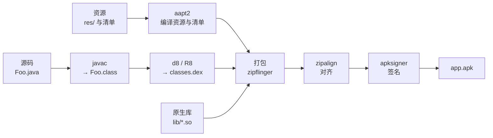
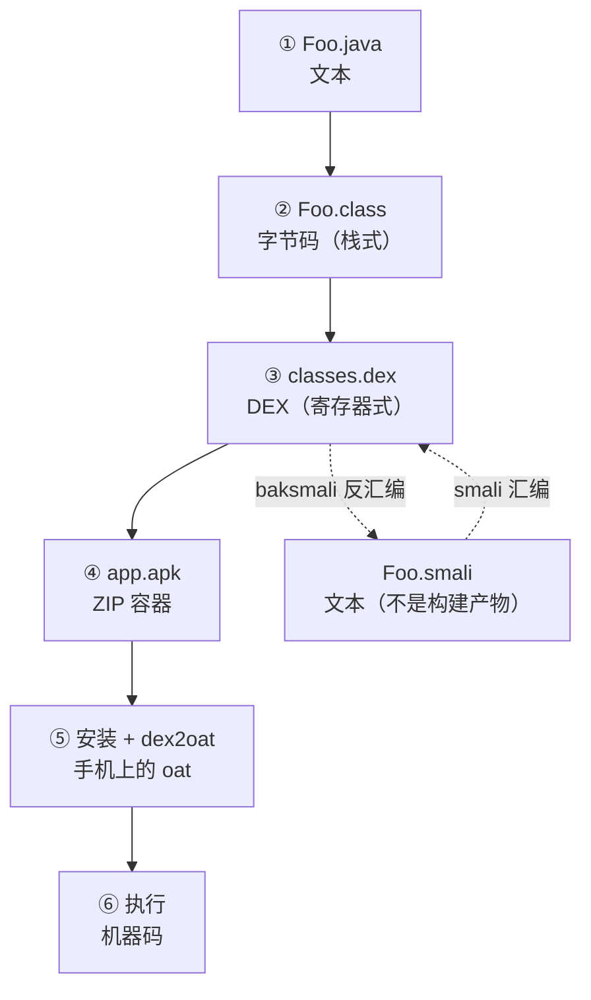

.8 # 本文章着重讲解Java在安卓中的*使用*途径与方式

# Java基础了解

## Java是什么

高级程序语言

##### （1）编译型语言

使用**编译器（Compiler）** 一次性将全部源代码翻译成目标平台的机器码，生成独立的可执行文件，运行时直接执行。

特点：运行速度快，执行效率高；跨平台需要针对不同系统 / CPU 重新编译。

代表语言：C、C++、Go、Rust、Fortran

对于不懂的CPU指令集,需要编译为不同的机器码

##### （2）解释型语言

使用**解释器（Interpreter）** 逐行读取源代码，逐行翻译成机器码并执行，不生成独立可执行文件。

特点：开发灵活，调试方便，跨平台性好；运行速度相对较慢，存在解释器开销。

代表语言：Python、JavaScript、PHP、Shell 脚本

##### （3）混合型（字节码 + 虚拟机）

先将源代码编译成与平台无关的**中间字节码**，运行时在专用虚拟机（VM）中解释执行，或通过即时编译（JIT）动态转成本地机器码。

特点：兼顾跨平台性（一次编写，到处运行）和执行性能，是企业级开发的主流方案。

代表语言：Java（JVM）、C#（CLR）、Kotlin

### 面向对象**OOP**(**O**bject **O**riented **P**rogramming)

### 的脚本语言

以 “类和对象” 为核心，<span style="color:#e64340">通过封装、继承、多态组织代码</span>

轻量化、快速开发，多用于胶水拼接、自动化脚本

Java特点

- <span style="color:#e64340">**Java是基于JVM虚拟机的跨平台语言，一次编写，到处运行；**</span>

- Java程序易于编写，而且有内置垃圾收集，不必考虑内存管理；

- Java拥有最广泛的开源社区支持，各种高质量组件随时可用。

Java语言常年霸占着三大市场：

- 互联网和企业应用，这是Java EE的长期优势和市场地位；

- Android移动平台。

```java
public class MyClass {
  public static void main(String[] args) {
    System.out.println("Hello World");
  }
}
```

修饰符,

在比赛中可找关键类和关键方法,通过接口和继承找到关键代码块

* **寄存器**（Register）：CPU 内部极小的存储单元，一般只有十几个到几十个，每个存一个字长的数据。CPU 算东西必须先把数据放进寄存器。

### 机器码-->汇编语言-->高级程序语言

机器码是二进制的，<u>人几乎没法直接读。所以有了**汇编语言**</u>（Assembly Language）：给每条机器指令起一个人能记的名字（`MOV`、`ADD`、`JMP`），一个助记符对应一条机器指令。

```
汇编（人写的）          机器码（CPU 读的）
  MOV  eax, 1      →     B8 01 00 00 00
  ADD  eax, 2      →     83 C0 02
  RET              →     C3
```

这个"汇编 ↔ 机器码"的对照关系，要记住，因为**第五部分要讲的 smali，本质上是给另一种机器码（dex）配的汇编语言**。

## Java的运行逻辑详解

先编译成一种中间的、不是机器码的"半成品语言"（字节码），运行时再由一个叫**虚拟机**的程序去执行它。虚拟机可以逐条解释字节码，也可以把热点部分当场编译成机器码。

### 为什么不直接运行代码?

#### CPU差异

**CPU 有不同的指令集**
CPU 只能识别自己专属的二进制机器指令：

- x86（Intel、AMD 电脑）
- ARM（手机、平板、树莓派）
- RISC-V、MIPS 等
  指令格式、指令含义完全不互通。一份给 x86 生成的机器码，ARM CPU 看不懂。

不同的CPU型号,对于同一个操作,有不同的操作码

为什么绕这么一圈？因为"半成品"不绑定任何 CPU。同一份字节码，Windows 的虚拟机能跑，ARM 手机的虚拟机能跑，x86 服务器的虚拟机能跑。这就是"一次编写，到处运行"的物理基础。

有了中间语言，**架构差异被推迟到最后一刻**：源码 → 字节码（与架构无关）→ 由各平台的虚拟机负责"字节码 → 本地机器码"。

### 源码到执行

#### .Java源代码-->编译器-->.class文件

**编译器**（Compiler）在这里具体指 `javac`——Java 编译器。它读 `.java` 文件，产出 `.class` 文件。中间它做的事，可以粗暴分成四步：

| 步骤                          | 干什么                                                        | 打个比方             |
| ----------------------------- | ------------------------------------------------------------- | -------------------- |
| 词法分析（Lexical Analysis）  | 把字符流切成一个个"词"（`public`、`class`、`Hello`、`{`）     | 把句子切成单词       |
| 语法分析（Syntax Analysis）   | 把词按语法规则拼成**抽象语法树**（Abstract Syntax Tree, AST） | 把单词拼成句子结构图 |
| 语义分析与类型检查            | 检查名字有没有定义、类型对不对、方法签名是否匹配              | 检查句子合不合逻辑   |
| 生成字节码（Code Generation） | 把语法树翻译成一串字节码指令，写进 `.class`                   | 把句子翻成外语       |

.class` 是**类文件**（Class File）：它不是给 CPU 的，是给**虚拟机**的。你不装 <u>Java 运行时</u>，双击它什么都不会发生。

##### .class` 里装的是四类东西：

1. **类的基本信息**：类名、父类、实现的接口、访问修饰符（`public`/`final`…）
2. **字段表**（Field Table）：有哪些成员变量，各是什么类型
3. **方法表**（Method Table）：有哪些方法，参数和返回值是什么，以及**每个方法的方法体被编译成的那串指令**
4. **常量池**（Constant Pool）：这张表最特别，见下。

**常量池**（Constant Pool）是一个"字符串和符号的仓库"。代码里出现的类名、方法名、字段名、字符串字面量、数字常量，都先在常量池里登记一个编号，指令里只写编号。这样做的目的是**省空间**——同一个类名在文件里出现 50 次，实际只存一份，其余位置存编号。

**字节码**（Bytecode）就是 `.class` 里那些指令。它不是机器码，也不是源码，是一种为虚拟机设计的指令集。

看一个最简单的例子：

```java
// 源码：Foo.java（人写的）
public class Foo {
    public int add(int a, int b) {
        return a + b;
    }
}
```

```text
public int add(int, int);
  Code:
     0: iload_1        // 把第 1 号局部变量压到栈顶
     1: iload_2        // 把第 2 号局部变量压到栈顶
     2: iadd           // 弹出栈顶两个数，相加，结果压回栈顶
     3: ireturn        // 弹出栈顶的数，作为返回值返回
```

#### .class文件-->JVM-->执行

**JVM**（Java Virtual Machine，Java 虚拟机）是一个普通的应用程序，跑在操作系统上,<u>它自己定义了一套指令集（就是字节码），自己定义了内存布局（栈、堆、方法区），自己负责把字节码变成真正 CPU 能做的工作。</u>

| 区域                | 中文名     | 装什么                                               | 谁共享       |
| ------------------- | ---------- | ---------------------------------------------------- | ------------ |
| Heap                | 堆         | 所有 `new` 出来的对象                                | 所有线程共享 |
| Method Area         | 方法区     | 类的结构信息、常量池、静态变量                       | 所有线程共享 |
| VM Stack            | 虚拟机栈   | 每个方法调用一个"栈帧"，栈帧里放局部变量表和操作数栈 | 每线程一份   |
| Native Method Stack | 本地方法栈 | 给 native 方法（C/C++ 写的）用的                     | 每线程一份   |
| PC Register         | 程序计数器 | 当前线程执行到字节码的第几条指令                     | 每线程一份   |

##### 字节码-->类加载器-->JVM

略

##### 字节码怎么被执行：解释、JIT、AOT

字节码进了内存，接下来的执行方式有三种，现代 JVM 是**混合**着用的：

**解释执行**（Interpretation）：虚拟机一条一条读字节码，读一条执行一段等价的机器码。启动快，但每条都要现翻，慢。

**即时编译**（Just-In-Time Compilation, JIT）：运行中统计哪些方法和循环被执行得特别频繁（叫**热点**，Hot Spot），把这些热点**整段编译成机器码**缓存起来，下次直接跑机器码。跑得越久越快，但编译本身要花时间和内存。

**提前编译**（Ahead-Of-Time Compilation, AOT）：在程序运行之前就把字节码编译成机器码。启动快，但不能根据实际运行情况优化。

#### 小结：Java 换来了什么，付出了什么

到这里，Java 的完整链路是清楚的：

```
Foo.java --javac--> Foo.class（字节码）--类加载--> 内存 --解释/JIT--> 机器码 --CPU--> 执行
```

**换来的**：跨平台、内存安全（虚拟机管内存，不会野指针）、动态加载（可以运行时加载新类）。

**付出的**：多了一层虚拟机，启动慢、占内存、峰值性能不如手写 C++（JIT 之后能追平很多场景）。

而安卓面对的正是"付出"那一栏——手机内存小、CPU 弱、电量有限、还要秒开。于是安卓做了一个大胆的决定：**把 JVM 换掉**。

***

# 安卓的炉灶

| 约束                              | 后果                                                                            |
| --------------------------------- | ------------------------------------------------------------------------------- |
| 内存只有几十 MB                   | 每个类加载进来都占内存，`.class` 文件里大量重复的字符串（类名、方法名）浪费严重 |
| CPU 主频几百 MHz，没有 JIT 的余力 | 纯解释执行必须尽量快，指令越少越好                                              |
| 电池有限                          | 少做无用功                                                                      |
| 应用启动要快                      | 不能等一堆小文件逐个读盘                                                        |

## dex：把一堆 .class 压成一张表

安卓的解法叫 **DEX**（<u>Dalvik</u> Executable[可执行的]）。它是一个**容器格式**，把整个应用的所有 `.class` 合并进一个文件，关键在于：

* **所有类共用一张常量池**。`java/lang/String` 只存一次，全应用共享。这一下省掉大量重复。

* **所有类、方法、字段被排成有序的索引表**，查找从"遍历文件"变成"查表"。

* **指令从栈式改成寄存器式**，指令条数大约减少三分之一。

生成 dex 的工具叫 **d8**（早期的叫 dx，已被 d8 取代）；如果还要做代码压缩混淆，用的是 **R8**。

```
传统 Java：  A.class  B.class  C.class  ...（各有各的常量池，互相重复）
Android：    classes.dex（一张共享常量池 + 所有类的方法体）
```

## 从 Dalvik 到 ART

**Dalvik**（达尔维克）是安卓 4.4 及以前的虚拟机，专门为 dex 设计，纯解释执行 + 一个简单的 JIT。

**ART**（Android Runtime，安卓运行时）从 Android 5.0 起取代 Dalvik，最大的变化是引入 **AOT(Ahead-of-Time) 编译**：应用**安装时**就把 dex 编译成机器码（`.oat` 文件），以后直接跑机器码，启动快、执行快，代价是安装慢、占空间大。

## 小结

| 问题             | Java 的答案          | 安卓的答案                   |
| ---------------- | -------------------- | ---------------------------- |
| 用什么装代码     | 一个类一个 `.class`  | 全应用一个 `classes.dex`     |
| 指令怎么算       | 栈式（操作数在栈顶） | 寄存器式（操作数在指定格子） |
| 谁执行           | JVM                  | ART（早期是 Dalvik）         |
| 何时编译成机器码 | 运行时 JIT           | 安装时 AOT / 运行时 JIT      |

# 安卓文件结构APK

## APK 就是一个 ZIP 压缩包

**APK**（Android Package，安卓安装包）本质上是一个 **ZIP 压缩包**，只是后缀改成了 `.apk`。

你可以直接把 `app.apk` 改名成 `app.zip` 然后用解压软件打开——会看到一堆文件。这说明 APK 不是什么神秘格式，它就是个容器。

**容器**（Container）这个词要理解准：容器本身不执行任何逻辑，它只负责"把若干文件按约定放在一起"，再加一些元信息（比如"哪个文件是入口"）。


| 文件 / 目录           | 必须吗    | 是什么                   | 对应 Java 世界的什么               |
| --------------------- | --------- | ------------------------ | ---------------------------------- |
| `AndroidManifest.xml` | 必须      | 应用清单（二进制格式）   | 相当于"程序的身份证 + 配置表"      |
| `classes.dex`         | 必须      | 编译后的代码             | 相当于所有 `.class` 的合订本       |
| `classes2.dex`…       | 可选      | 多 dex 的后续包          | 方法数超 64K 时的分册              |
| `resources.arsc`      | 有资源时  | 编译后的资源索引表       | 相当于 `R.java` 里那些数字背后的表 |
| `res/`                | 有资源时  | 编译后的资源文件         | 图片、布局、字符串                 |
| `assets/`             | 可选      | 原样打包的文件           | 不编译，读的时候自己解析           |
| `lib/<架构>/*.so`     | 可选      | 原生库（C/C++ 编译产物） | JNI 用的                           |
| `META-INF/`           | v1 签名时 | 签名文件                 | 证明"这个包是谁做的、没被改过"     |

### AndroidManifest.xml清单文件

这个文件规定了这个应用的"身份"和"能力"：

* 包名（`package="com.example.app"`）——应用的唯一标识

* 版本号、最低支持的安卓版本

* 有哪几个**组件**（Activity 界面、Service 后台服务、BroadcastReceiver 广播接收器、ContentProvider 数据提供者）

* 声明需要哪些**权限**（相机、网络、存储…）

* 哪个 Activity 是启动入口

### classes.dex真正会执行的代码

梳理一下

.java-(Javac编译)->.class-(d8)->classes.dex-(安卓虚拟机)->执行

APK 不是手搓的，是一串工具接力做出来的：



每一步的产物都在构建目录里,可溯源,可查找.

### 小结:APK 各文件 ↔ 程序概念

| 程序里的概念               | APK 里的落点              |
| -------------------------- | ------------------------- |
| 代码逻辑                   | `classes.dex`             |
| 类结构、方法签名、常量     | `classes.dex` 里的索引表  |
| 资源（字符串、图片、布局） | `res/` + `resources.arsc` |
| 应用配置、组件声明、权限   | `AndroidManifest.xml`     |
| 原生代码                   | `lib/<abi>/*.so`          |
| 身份与完整性               | `META-INF/` + 签名块      |

到这里，你打开一个 APK 的 `classes.dex`，会看到一堆二进制。**人读不了**。于是有了下一部分的主角。

# smali：dex 的可读写法

## smali 不是一门语言，是 dex 的文本形态

先把最容易误解的一点说清：

**smali 不是一种编程语言，它没有编译器，也没有自己的语义。它只是 dex 的助记符写法。**

就像<u>汇编不是"一种高级语言"，只是机器码的助记符写法一样。</u>

两者的关系是**双向**的：

```
classes.dex  --baksmali（反汇编）-->  一堆 .smali 文本文件
一堆 .smali  --smali（汇编）-->      classes.dex
```

## 为什么要有它

1. **二进制不可编辑**。想改一个方法的返回值，改二进制几乎不可能；改文本 smali 则很容易。
2. **反编译成 Java 会失真**。`jadx` 把 dex 还原成 Java，遇到混淆代码、lambda、内联优化时会"猜错"，生成的 Java 甚至编译不过。smali 是 dex 的忠实映射，不猜。
3. **它是 dex 与人的最小距离**。看懂 smali 就等于看懂 dex，中间不再隔一层翻译。

## 一个 .smali 文件的骨架

一个类对应一个 `.smali` 文件。骨架长这样（以 `Foo` 为例）：

```smali
.class public Lcom/example/Foo;      # 类声明：访问标志 + 全限定名
.super Ljava/lang/Object;            # 父类
.source "Foo.java"                   # 源文件名（调试用，可无）

# 字段声明
.field private static final TAG:Ljava/lang/String; = "Foo"

# 方法声明
.method public constructor <init>()V
    .locals 0
    invoke-direct {p0}, Ljava/lang/Object;-><init>()V
    return-void
.end method
```

## 寄存器：smali 最核心的概念

smali 里没有"变量名"，只有**寄存器**（Register），用 `v` 和 `p` 编号：

* `v0`、`v1`、`v2`… 是**局部寄存器**（Local Register），放局部变量和中间结果

* `p0`、`p1`、`p2`… 是**参数寄存器**（Parameter Register），放参数

## 小结

* smali = dex 的文本写法，与 dex 可双向转换，不是新语言。

* 三个必须记住的规则：`p0` 是 `this`、`.locals` 不含参数、`move-result` 紧跟 `invoke`。

* 读 smali 的顺序：先看 `.method` 签名（知道参数是谁），再看 `.locals`（算出寄存器总数），最后逐条读。

# 三者如何咬合

## 从一条时间线来看

| 时间点          | 在哪 | 发生什么                                                                    | 此时的形态                                    |
| --------------- | ---- | --------------------------------------------------------------------------- | --------------------------------------------- |
| ① 你敲完代码    | 电脑 | 存在 `.java` 文件里                                                         | 文本                                          |
| ② 点"运行/构建" | 电脑 | `javac` 编译                                                                | `.class`（字节码）                            |
| ③ 构建继续      | 电脑 | `d8` 把 `.class` 合并转换                                                   | `classes.dex`                                 |
| ④ 构建收尾      | 电脑 | aapt2 + 打包 + 签名                                                         | `app.apk`                                     |
| ⑤ 安装          | 手机 | `PackageManagerService` 解析、校验、`dex2oat` 预编译                        | 解压到 `/data/app/...`，生成 `.oat` / `.vdex` |
| ⑥ 启动          | 手机 | `zygote` fork 出进程，`ActivityThread` 加载 APK，`ClassLoader` 读 dex，执行 | 机器码（运行时）                              |

**第 ③ 步之后，`.class`** **就消失了**。APK 里没有 `.class`，只有 dex。

**`.smali`** **从未出现在这条线上**。它是从 dex 反推出来的"阅读产物"，不是构建产物。



## 同一个方法(函数)的四种形态并排

看一个方法在四个阶段的四张脸。源码：

```java
public static int twice(int x) {
    return x * 2;
}
```

**形态 1：字节码**（`javap -c` 输出，javac 生成）

```text
public static int twice(int);
  Code:
     0: iload_0        // 压入第 0 号局部变量（静态方法，0 号就是第一个参数）
     1: iconst_2       // 压入常量 2
     2: imul           // 相乘
     3: ireturn        // 返回
```

**形态 2：DEX 指令**（`dexdump -d` 输出，d8 生成）

```text
twice: (I)I
0000: mul-int v0, p0, v1     ; 需要先把常量 2 放进 v1
0002: return v0
```

**形态 3：smali**（baksmali 生成）

```smali
.method public static twice(I)I
    .locals 2
    const/4 v1, 0x2          # v1 = 2
    mul-int v0, p0, v1       # v0 = p0 * v1
    return v0
.end method
```

**形态 4：Java（反编译回来）**

```java
public static int twice(int x) {
    return x * 2;
}
```

# 实践题目

1.查看APK文件修改后缀观察

2.反编译一个APK文件

3.做一道简单题目,看看如何从APK中精准锁定关键点
